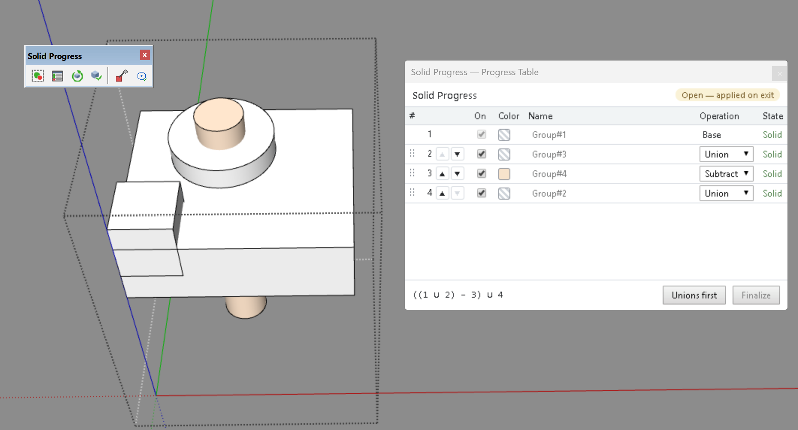

# Solid Progress — User Manual

*[Version française](USER_MANUAL_FR.md)*

Version 2.0.2 — SketchUp Pro 2021 and SketchUp Make 2017

## Overview

Solid Progress is a SketchUp plugin for **non-destructive boolean modelling**. A **Solid Progress group** is a group that holds:

- its **source volumes** — solid groups or components, added or subtracted;
- its **Result** — the combination of the sources, computed with SketchUp Pro's native booleans (with SketchUp Make, with the built-in engine).

Inside the group you edit the sources; outside, you see the Result, rebuilt automatically when you close the group. When the part is done, **Finalize** turns it into a plain solid, ready for the STL export.

The commands are in the **Extensions > Solid Progress** menu, the **Solid Progress** toolbar and the context menu (right-click).

Solid Progress installs next to **Solid Batch**, which keeps its one-click, destructive Combine All.

## Requirements

- **SketchUp Pro 2021** (tested with 21.0.391) or **SketchUp Make 2017** (tested with 17.2.2555), on Windows. SketchUp Pro uses its native booleans; SketchUp Make uses the built-in engine (see [SketchUp Make 2017](#sketchup-make-2017)).
- Every source must be a **solid** group or component (Entity Info shows "Solid Group" or "Solid Component").

## Concepts

| Term | Meaning |
|------|---------|
| **Solid Progress group** | A group created by *Create Solid Progress*. Selected, it shows a **green** frame |
| **Source** (volume) | A solid group or component inside the Solid Progress group |
| **Result** | The combination of the enabled sources, in order. Visible when the Solid Progress group is closed, hidden while you edit it |
| **Base** | Row 1 of the list: the volume the others are added to or subtracted from. Always first and always enabled |
| **Operation** | For every other row: **Union** (add), **Shell** (add with *Outer Shell*: internal faces removed), **Subtract** (remove) |
| **Subtract color** | Painting a volume with this color (red by default) makes it a Subtract volume; repainting it with another color makes it an added volume again |

The Result takes the material of the Base; the faces cut by a subtracted volume do not keep the subtract color.

## Basic workflow

1. **Model the volumes** — a base, the volumes to add, the volumes to remove (holes, slots), each as a solid group. Volumes to add overlap a little, holes go through (see [Drawing volumes that combine well](#drawing-volumes-that-combine-well)).
2. **Paint the volumes to remove** with the subtract color (red by default).
3. **Select them all** and click **Create Solid Progress**. The order is: every added volume, then every subtracted one. The Result appears, the sources are hidden. Check in the Progress Table which volume is the Base (its material is the one of the Result); choose *Base* on another row to change it.
4. **Edit** — double-click the Solid Progress group: the sources appear, the Result is hidden. Move a hole, resize a pin, paint a volume, add a new solid group (it goes last in the list).
5. **Close** the Solid Progress group (click outside or Escape): if the sources changed, the Result is rebuilt. The Ruby Console shows `[Solid Progress] Rebuild '…'`; nothing is rebuilt when nothing changed.
6. **Adjust** the order and the operations in the **Progress Table**.
7. **Finalize** before exporting to STL.

### Example: plate with a hole and a pin

To try Solid Progress on a ready-made part, open the demo model `docs/demo.skp` (the part of the video).

1. A plate (base), a pin standing on it, a red cylinder through both (hole).
2. *Create Solid Progress*: Base (the plate — check it in the table), then the pin (added), then the hole (subtracted) → the hole goes through the pin too: a tube.
3. In the Progress Table, move the pin after the hole → the pin is full again; the hole stays in the plate, under the pin.

### Drawing volumes that combine well

The solid operations of SketchUp (and the built-in engine of SketchUp Make) handle volumes that only **touch** poorly: faces in simple contact, an edge of one volume lying exactly on an edge of another, circles or arcs that are tangent or coincide. The combination may then not be a solid: Solid Progress refuses it.

- **Volumes to add: make them overlap.** Sink a pin slightly into the plate it stands on instead of setting it exactly on the face; make a part that fills a recess slightly larger than the recess (for example a diameter 0.1 mm larger).
- **Volumes to remove: make them go through.** A hole starts below and ends above the faces it cuts.
- **If a contact must stay exact**, check that the volumes still combine: close the Solid Progress group and check that the Result is a solid (Entity Info: *Solid Group*).

Solid Progress names the volume whose combination is not a solid: *Union of volume #4 … gives a result that is not a solid* (see [Troubleshooting](#troubleshooting)).

## Commands

### Create Solid Progress

Select one or more solid groups or components, then click **Create Solid Progress**.

- The selection is grouped into a new Solid Progress group named `Solid Progress` and its Result is computed.
- Every object must be a solid; otherwise a message lists the objects to repair or deselect.
- At least one object must **not** have the subtract color.
- A Solid Progress group cannot be used as a volume of another one (nesting is not supported): to reuse a sub-part, finalize it first.
- One Ctrl+Z undoes the whole creation.

### Progress Table

Opened by the menu, the toolbar button (after *Create*) or a right-click on a Solid Progress group (selected or open). The window stays open while you work.

The table shows the **open** Solid Progress group, or else the **selected** one. Its header shows the name and the mode:

- **Closed — applied now** (green): the Solid Progress group is closed; every change rebuilds the Result at once and keeps it selected.
- **Open — applied on exit** (yellow): you are editing the Solid Progress group; changes are applied when you close it.

| Column | Use |
|--------|-----|
| **#** | Position. Drag a row by its handle ⋮⋮ or use ▲▼ to move it. Row 1 (Base) cannot move and nothing can go above it |
| **On** | Uncheck to ignore a volume (it stays in the group). The Base is always enabled |
| **Color** | Material of the volume (hatched = default material) |
| **Name** | Click to rename; Enter validates, Escape cancels |
| **Operation** | *Base* on row 1; Union / Shell / Subtract on the other rows. **Subtract** paints the volume with the subtract color (its former material comes back when it leaves Subtract). Choosing **Base** on another row makes it the new Base (the former Base goes to row 2) |
| **State** | `Solid`, `Not solid`, `Disabled`, `Base must be added` (row 1 has the subtract color), `Nested: not supported yet` |

Below the table:

- the **formula** of the operations actually computed, enabled rows in order, for example `(((1 ∪ 2) shell 3) − 4) ∪ 6`;
- **Unions first**: the Base, then every Union and Shell, then every Subtract, each in its current order;
- **Finalize**: the same as *Finalize Solid Progress* on the Solid Progress group shown. Greyed while it is open: close it first. One Ctrl+Z brings it back.

**Selection:**

- in an open Solid Progress group, clicking a row selects its volume, and selecting a volume highlights its row;
- on a closed Solid Progress group, double-clicking a row opens it and selects the volume (not with SketchUp 2017: see [SketchUp Make 2017](#sketchup-make-2017)).

**Keyboard:** after an action in the table (and when the mouse leaves it), the keyboard goes back to SketchUp, so its shortcuts (W, etc.) work without clicking in the model. While you type a name, the field keeps the keyboard until Enter or Escape.

Every change of the table is **one Ctrl+Z**, its rebuild included.

### Rebuild Solid Progress

Rebuilds the **selected** Solid Progress groups, even if nothing changed (for example after changing the repair options). A Solid Progress group being edited is rebuilt when you close it.

### Finalize Solid Progress

Replaces each selected Solid Progress group by its Result: a plain solid group that keeps the name and the tag of the Solid Progress group; the sources are deleted. The Result is rebuilt first if needed. One Ctrl+Z brings the Solid Progress group back.

**Always finalize before an STL export**: the export would also include the hidden sources of a Solid Progress group. The green selection frame reminds you which objects are not finalized yet.

### Set Subtract Color

Select a group or component with a material and click **Set Subtract Color**: that color now marks the volumes to subtract. Default: red (255, 0, 0). The existing volumes keep their operation until they are repainted.

### Set Repair Options

Settings of the circle and arc restoration done on every Result:

- **Auto-repair circles on large objects** (Yes/No): with `No`, the restoration is skipped above the threshold and a message tells you;
- **Large object threshold (edges)**: default `10000`;
- **Min segments for arc detection**: default `6`, minimum `3`. Lower catches shorter arcs but risks false positives.

Since version 1.1.1, the restoration is 4 to 5 times faster on a face with many holes (about 2 s for a plate with 20 holes). If you had lowered the threshold or chosen `No` because it was slow, you can raise it again.

| Arc type | Segments | Detected with threshold = 6? |
|----------|----------|------------------------------|
| 360° with 24 segments (refined native circle) | 24 | ✓ (circle) |
| 270° with 12 segments (default native arc) | 9 | ✓ |
| 180° with 12 segments | 6 | ✓ |
| 90° with 24 segments | 6 | ✓ |
| 90° with 12 segments | 3 | ✗ — lower the threshold to 3 |

The settings of Solid Batch are used until you change them here.

## Circles and arcs of the Result

The booleans break circles and arcs into segments. Each Result goes through the restoration of Solid Batch (method of Re-Cercle):

| Case in the Result | Result |
|--------------------|--------|
| Through hole, blind hole, pin, truncated cone | Both end circles become **native** |
| Circle or arc on a flat face | **Native** circle or arc |
| Circle crossed by a line | **Native** arcs between the crossings |
| Arcs of a rounded edge, intersecting or stacked holes, circle on a curved surface, oblique cylinder | **Welded** into one curve (selected in one click, no center inference) |

A summary is shown in the status bar and, with the reason of each weld, in the Ruby Console. If the restoration fails, the boolean Result is kept as it is and a message tells you.

## Undo and redo

- The automatic rebuild on exit is merged with your last edit: **one Ctrl+Z** undoes the edit and its Result together; Ctrl+Y redoes both.
- Every command and every change of the table is one undo step.

## Explode

Exploding a Solid Progress group gives back the Result **and** all the source volumes as plain, visible groups. One Ctrl+Z brings the Solid Progress group back. To keep only the Result, use **Finalize** instead.

## Green selection frame

While the selection holds only Solid Progress groups, SketchUp's selection frame is green; otherwise it keeps its usual color. The green is never saved in the file, and selecting a Solid Progress group does not mark the model as modified.

## SketchUp Make 2017

SketchUp Make has no native booleans. Solid Progress then uses its **built-in engine** — the engine of Solid for Maker, based on Eneroth Solid Tools (MIT License) — for Union, Shell and Subtract. Everything else works as with SketchUp Pro, with these differences:

- **Speed** — the built-in engine is slower: on a part with many volumes or holes, the rebuild when you close the Solid Progress group can take a few seconds (progress in the status bar).
- **Progress Table** — SketchUp 2017 does not let a plugin open a group: double-clicking a row does not open the Solid Progress group, and a message in the table (and in the status bar) tells you to double-click the Solid Progress group in the model. Once it is open, clicking a row selects its volume as usual. The message goes away at the next action in the table.
- **Shell and enclosed volumes** — a volume entirely enclosed in another one is removed by the built-in Shell. SketchUp Pro's native Outer Shell keeps it inside the Result: hidden, but exported.
- **Circles** — the circles and arcs of the Result are rebuilt as native circles too. The weld fallback needs SketchUp 2020.1: with SketchUp 2017, a circle that cannot be rebuilt natively stays as segments (for example the circle shared by a countersink whose cone meets the hole).
- **Counterbores and countersinks** — since version 1.1.2, a counterbore or countersink cut after its hole works with the built-in engine too (before, the rebuild failed with *Subtract of volume … failed*).

## Troubleshooting

| Message | Meaning |
|---------|---------|
| *These objects are not solids: …* | Repair the listed objects (holes, stray edges) or deselect them |
| *No base volume found: all the selected objects have the subtract color* | Repaint at least one object with another color |
| *Volume #2 … is not a solid.* | A source was damaged while editing: repair it; the former Result is kept |
| *Subtract of volume #3 … failed.* | The boolean failed (native with SketchUp Pro, built-in engine with SketchUp Make; volumes that do not touch, coplanar faces…): move or simplify the volume |
| *Union of volume #4 … gives a result that is not a solid. …* | This volume only touches another one (faces in simple contact, edges that coincide, tangent circles or arcs) and their combination is not a solid. Make the volumes overlap, or enlarge or move this volume slightly (see [Drawing volumes that combine well](#drawing-volumes-that-combine-well)). Nothing is changed; when you close a Solid Progress group, your edit and the former Result are kept |
| *Double-click the Solid Progress group in the model to open it …* (table) | SketchUp 2017: the table cannot open a Solid Progress group; double-click it in the model |
| *PRO Only vs. procedural.rb:…* | This copy of the plugin was set to SketchUp Pro only (a line uncommented in `solid_progress/procedural.rb`): nothing is changed. To use it with SketchUp Make, comment that line out again (`#` at its start) and restart SketchUp |
| *The first volume … has the subtract color* | The Base is painted with the subtract color: repaint it, or choose *Base* on another row |
| *The base volume is always enabled* | Choose *Base* on another row before disabling this volume |
| *Close the Solid Progress group to rebuild it* | *Rebuild* works on closed Solid Progress groups; an open one is rebuilt when you close it |
| *Nested Solid Progress groups are not supported yet* | A Solid Progress group cannot be a volume of another one: finalize it first |
| *… Solid Progress group(s) out of date* (status bar) | After an undo, a Result no longer matches its sources: open and close it, or use *Rebuild* |

Loose edges and faces inside a Solid Progress group are not volumes: make them a group to use them.

## Limitations

- Nesting of Solid Progress groups is not supported (finalize a sub-part to reuse it).
- The Result is rebuilt when you close the Solid Progress group, not while you edit it; on a closed Solid Progress group, the Progress Table applies its changes at once.
- Faces rebuilt around a repaired circle keep their material, tag and orientation, but lose their texture position and attributes. A regular polygon of 6 sides or more cannot be told apart from a circle.
- Tested on SketchUp Pro 2021 and SketchUp Make 2017 (Windows). Expected to work on SketchUp 2017 to 2027 (checked against the Ruby API release notes, not tested).
